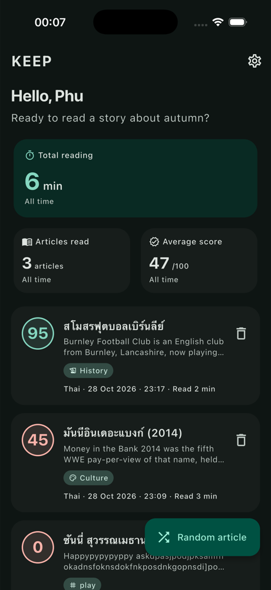
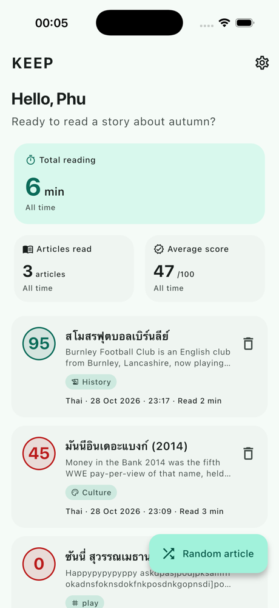
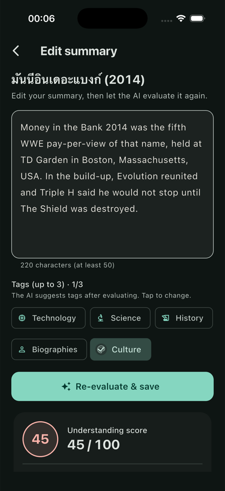
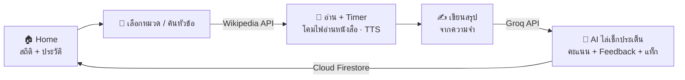

<div align="center">


# KEEP — ฝึกอ่านจับใจความด้วย Active Recall

**สุ่มบทความ Wikipedia → อ่านแบบจับเวลา → ปิดบทความแล้วเขียนสรุปจากความจำ → AI ไล่เช็กทีละประเด็นว่าครอบคลุมแค่ไหน**

<sub>โครงงานพัฒนา Mobile Application · Flutter · รองรับ English / Chinese / Thai</sub>

[](https://flutter.dev)
[](https://dart.dev)
[](https://firebase.google.com)
[](https://console.groq.com)
[](https://www.mediawiki.org/wiki/API:Main_page)
[](#-เริ่มใช้งาน)


&nbsp;

&nbsp;


<sub>หน้า Home (โหมดมืด / โหมดสว่าง) และหน้าเขียนสรุปพร้อมคะแนนความเข้าใจ</sub>

</div>

---

## 📌 สารบัญ
- [ภาพรวม](#-ภาพรวม)
- [ฟีเจอร์](#-ฟีเจอร์)
- [AI ให้คะแนนอย่างไร](#-ai-ให้คะแนนอย่างไร)
- [เริ่มใช้งาน](#-เริ่มใช้งาน)
- [ทดสอบ](#-ทดสอบ)
- [โครงสร้างโปรเจกต์](#-โครงสร้างโปรเจกต์)
- [เอกสารเพิ่มเติม](#-เอกสารเพิ่มเติม)

## 🔍 ภาพรวม
อ่านแล้วจำไม่ได้ เพราะอ่านผ่านๆ ไม่ได้ทบทวน KEEP ให้ฝึก **Active Recall**: อ่านบทความจริงแบบจับเวลา
แล้วปิดบทความ เขียนสรุปจากความจำ ให้ AI บอกว่าเข้าใจครบแค่ไหนและขาดประเด็นอะไร



| ส่วน | เทคโนโลยี |
|:--|:--|
| แอป | Flutter + Dart, Material 3 (ธีมสว่าง/มืด) |
| บัญชีและข้อมูล | Firebase Authentication (Email/Password), Cloud Firestore + Security Rules |
| บทความ | Wikipedia API (`en` / `zh` / `th`) ผ่าน interface `ArticleSource` (เพิ่มแหล่งอื่นได้) |
| AI | Groq API (OpenAI-compatible) · `qwen/qwen3.8-27b` |
| ในเครื่อง | SharedPreferences (ตั้งค่า, เซสชันที่อ่านค้าง), flutter_tts, image_picker, url_launcher |
| หลายภาษา | `flutter_localizations` + ARB (`flutter gen-l10n`) |

## ✨ ฟีเจอร์
- **สุ่มบทความใหม่ทุกครั้ง** ไม่ซ้ำเรื่องที่เคยอ่าน เลือกหมวดยอดฮิตหรือค้นหัวข้อเองได้ ตัดเชิงอรรถ ตาราง และส่วนอ้างอิงออกให้อ่านได้ลื่น
- **หน้าอ่านแบบโคมไฟ**: พื้นสีถ่าน (หรือกระดาษอุ่นในโหมดสว่าง) มีแสงนุ่มๆ ไหลตามนิ้วและ "หายใจ" ระหว่างจับเวลา หัวข้อบทความเป็นตัวหนา
- **Timer + พักไว้อ่านต่อ**: ออกจากหน้าอ่านได้ การ์ดบนหน้า Home พากลับมาอ่านหรือเขียนสรุปต่อ
- **ฟังบทความ (TTS)** ทีละย่อหน้า ปรับความเร็วได้ ไฮไลต์ย่อหน้าที่กำลังอ่าน
- **AI ตรวจสรุป** แบบไล่เช็กทีละประเด็น พร้อม Feedback และแนะนำแท็ก สรุปเป็นคนละภาษากับบทความได้
- **สถิติและประวัติ**: เวลาอ่านสะสม จำนวนบทความ คะแนนเฉลี่ย แก้ไขหรือลบสรุปได้
- **3 ภาษา** แยกตั้งค่าได้ทั้งภาษาแอป ภาษาบทความ และภาษาเสียงอ่าน
- **เข้าถึงได้**: รองรับ Reduce Motion และตัวอักษรขนาดใหญ่ (เทสต์ที่ 3 เท่า) screen reader อ่านค่าเต็ม

## 🤖 AI ให้คะแนนอย่างไร
AI ไม่ได้เดาตัวเลขคะแนน แต่ทำงานเป็นขั้นตอน แล้วแอปคำนวณคะแนนเอง (`SlmService.scoreOf`)

1. ระบุ **ประเด็นสำคัญ 6–8 ข้อ** ทั่วทั้งบทความ ติดป้าย `core` (เรื่องหลัก) หรือ `detail` (ข้อมูลประกอบ)
2. เช็กแต่ละประเด็นว่าสรุปครอบคลุมไหม และ **คัดลอกข้อความจากสรุปมาเป็นหลักฐาน**
3. ระบุข้อความในสรุปที่ขัดกับบทความ

| กติกา | ผล |
|:--|:--|
| ประเด็น `core` | หนัก 2 เท่าของ `detail` |
| ครอบคลุม + หลักฐานมีอยู่ในสรุปจริง | ได้เต็ม |
| ครอบคลุม แต่หาหลักฐานในสรุปไม่เจอ | ได้ครึ่งเดียว |
| ข้อมูลผิด | หักข้อละ 10 (สูงสุด 30) |

<sub>ตัวอย่างจริง (บทความ "สโมสรฟุตบอลเบิร์นลีย์" ภาษาไทย สรุปเป็นภาษาอังกฤษ): สรุปละเอียด 1,656 ตัวอักษร ได้ 100 · สรุปสั้น 2 ประโยค ได้ 45</sub>

## 🚀 เริ่มใช้งาน
ต้องมี Flutter (Dart ^3.12), Xcode (iOS 15.0 ขึ้นไป) หรือ Android Studio, โปรเจกต์ Firebase และ API key ของ Groq (ฟรี)

```bash
git clone https://github.com/thanapond-vi/project-moblie-dev.git && cd project-moblie-dev
cp .env.example .env              # ใส่ GROQ_API_KEY
flutterfire configure             # สร้าง firebase_options.dart + ไฟล์ config ของ iOS/Android
firebase deploy --only firestore:rules
flutter pub get
flutter run
```

- เปิด **Email/Password** ใน Firebase Authentication และสร้าง Cloud Firestore ก่อนรัน
- ไฟล์ที่มีค่าเฉพาะโปรเจกต์ (`.env`, `lib/firebase_options.dart`, `google-services.json`, `GoogleService-Info.plist`) ไม่อยู่ใน Git ต้องสร้างเองตามขั้นตอนด้านบน
- เปลี่ยนโมเดล AI ได้ที่ `GROQ_MODEL` ใน `.env` โดยไม่ต้องแก้โค้ด

## 🧪 ทดสอบ
```bash
flutter analyze
flutter test                      # ทั้งหมดทำงานออฟไลน์ (จำลอง Wikipedia/Groq ด้วย MockClient)
LIVE=1 flutter test test/live     # เรียก API จริง ใช้โควตา Groq
```
ครอบคลุมการให้คะแนนของ AI, การทำความสะอาดบทความ, ธีมสว่าง/มืด, Reduce Motion, ตัวอักษรใหญ่, การตั้งค่า และ animation

## 🧭 โครงสร้างโปรเจกต์
```text
lib/
├── main.dart                 .env → Settings → Firebase → MaterialApp (ธีม + ภาษา) → AuthGate
├── core/                     theme.dart (ธีม, ReadingLampColors), spacing.dart, motion.dart, validators
├── models/                   Article, StudyLog, ReadingSession, ContentLanguage, ArticleTag, UserProfile
├── services/                 slm_service (Groq), sources/wikipedia_source, study_log_repository (Firestore),
│                             session_service, settings_service, tts_service, profile/auth/greeting
├── screens/                  auth · onboarding · home · reading · summary · profile
├── widgets/                  reading_lamp, animated_counter (การ์ดสถิติ), score_badge, start_session_sheet
└── l10n/arb/                 app_en.arb · app_th.arb · app_zh.arb
test/                         unit + widget tests (ออฟไลน์), test/live = เรียก API จริง
docs/                         architecture.md · workflow.md · plan.md · images/
firestore.rules               ผู้ใช้อ่าน/เขียนได้เฉพาะข้อมูลของตัวเอง
.interface-design/system.md   ระบบดีไซน์: สี, ตัวอักษร, ระยะห่าง, component
```

## 📚 เอกสารเพิ่มเติม
- [docs/architecture.md](docs/architecture.md) — สถาปัตยกรรม, Database, Async และคำถามที่อาจโดนถาม
- [docs/workflow.md](docs/workflow.md) — สเปกการทำงานของแต่ละหน้า
- [docs/plan.md](docs/plan.md) — ตารางงาน
- [.interface-design/system.md](.interface-design/system.md) — ระบบดีไซน์

## 👤 ผู้พัฒนา
**Thanapond Visessang** · [@thanapond-vi](https://github.com/thanapond-vi)

## 🙏 ขอบคุณ
[Wikipedia](https://www.wikipedia.org) (เนื้อหา CC BY-SA) · [Groq](https://groq.com) · [Firebase](https://firebase.google.com) · [Flutter](https://flutter.dev)
